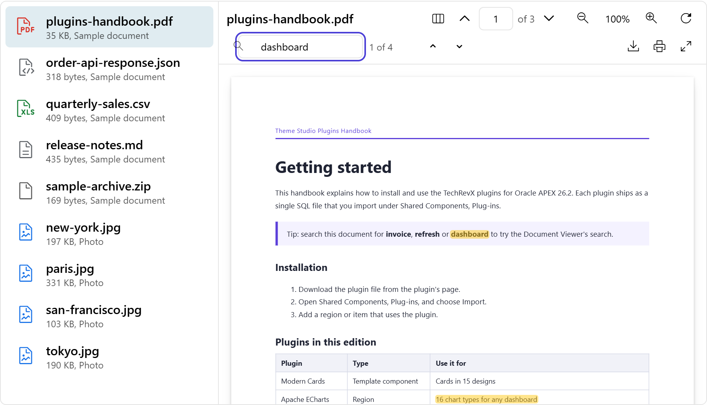

# Document Viewer for Oracle APEX

Preview PDFs, images, text, CSV, JSON, video and audio from a table, with a document list, search, thumbnails, zoom, download and print.

[](https://oracleapex.com/ords/r/aamirkhanz/plugins/document-viewer) &nbsp; Sign in as `demo` with the password `Demo`.



| | |
|---|---|
| **Type** | Region plug-in |
| **Internal name** | `COM.TECHREVX.DOCUMENT_VIEWER` |
| **Version** | 1.0 |
| **Requires** | Oracle APEX 26.2 or later |
| **License** | MIT |

## What it does

Document Viewer shows the files stored in a table without downloading them first. The documents appear in a list; the selected one opens next to it with a toolbar for its type.

- **PDF**: pages drawn with PDF.js, thumbnails, page navigation, zoom (fit width, fit page, 100%), rotation, selectable text and search with highlighting.
- **Images**: zoom, drag to pan, rotate.
- **Text, CSV and JSON**: CSV as a table, JSON formatted, Markdown, XML, SQL and log files as text, all searchable.
- **Video and audio**: played in the page.
- **Everything else**, such as Word or Excel files: a file card with a download button.

Files are sent to the browser one at a time, only when opened, and only for rows of the region's own query, so the query and your authorization schemes decide who sees which file.

## At a glance

- **Source**: any region source with one row per document. Map ID and File Name, then Content (BLOB) or URL. MIME Type, Size and Description are optional.
- **PDF**: drawn with PDF.js 6.4.299 (included): page navigation, thumbnails, text search with highlighting, selectable text, zoom (fit width, fit page, 100%), rotate.
- **Images**: zoom, pan and rotate. Text, CSV (as a table), JSON (formatted), XML, SQL, Markdown and log files: readable preview with search. Video and audio: played in the page. Other types (for example Office files): file card with a download button.
- Files are sent one at a time when opened, only for rows of the region's own source, so Authorization and the source query decide who can see what.
- **JavaScript**: apex.region( "id" ).refresh() reloads the list; apex.region( "id" ).open( documentId ) opens a document.
- **Events**: Document Viewer - Document Selected and Document Loaded, with this.data = { id, name, mimeType, pages }.

## Installation

1. Download `plugin/region_type_plugin_com_techrevx_document_viewer.sql` from the [latest release](https://github.com/aamirkhanz/apex-plugin-document-viewer/releases/latest) (or from this repository).
2. In App Builder, open your application and go to **Shared Components > Plug-ins**.
3. Choose **Import**, select the file and finish the wizard.
4. Create a region of type **Document Viewer [Plug-in]**, write the query and map the ID, name and BLOB columns.

Everything the plug-in needs is inside the SQL file, including PDF.js; it loads nothing from other sites.

## Example

```sql
select doc_id, file_name, mime_type, file_blob,
       'Uploaded by ' || created_by as description
  from project_documents
 where project_id = :P10_PROJECT_ID
 order by created_on desc
```

```text
ID Column            DOC_ID
File Name Column     FILE_NAME
MIME Type Column     MIME_TYPE
Content Column       FILE_BLOB
Description Column   DESCRIPTION
Page Items to Submit P10_PROJECT_ID
```

Files that are not in the database can be shown with the URL Column instead, for example `#APP_FILES#manual.pdf`.

## Attributes

### Data

| Attribute | Type | Default | Description |
|---|---|---|---|
| **ID Column** (required) | Region source column |  | Unique key of each document. Set Item on Selection stores it, and the viewer opens the document whose key is in that item when the page loads. |
| **File Name Column** (required) | Region source column |  | Name shown in the list and toolbar and used for downloads, for example handbook.pdf. |
| **MIME Type Column** | Region source column |  | Optional. The file type, such as application/pdf or image/png. When empty, the type comes from the file name's extension. |
| **Content Column** | Region source column |  | The file itself (BLOB). Files are sent to the browser one at a time, only when opened, and only for rows of this region's source. Leave empty when every row has a URL instead. |
| **URL Column** | Region source column |  | Optional address of the file, used when the row has no content, for example #APP_FILES#manual.pdf or an https link. Files on other web sites must allow cross-origin requests to be previewed. |
| **Size Column** | Region source column |  | Optional file size in bytes. When empty, the size of the Content Column is used. |
| **Description Column** | Region source column |  | Optional second line in the document list, for example who uploaded the file and when. |

### Appearance

| Attribute | Type | Default | Description |
|---|---|---|---|
| **Layout** (required) | Select list | `list` | Document List: the documents on the left, the open one on the right. Single Document: only the viewer, showing the first row (or the one in Set Item on Selection), for example on a detail page. Values: `list` Document List, `single` Single Document. |
| **Height** (required) | Integer | `640` | Height of the viewer in pixels. Full Screen in the toolbar uses the whole screen. |
| **List Width** (required) | Integer | `280` | Width of the document list. On narrow screens the list moves above the viewer. Shown when Layout is `list`. |

### Viewer

| Attribute | Type | Default | Description |
|---|---|---|---|
| **Toolbar** | Checkboxes | `pages:zoom:search:thumbnails:rotate:download:print:fullscreen` | Pages and Thumbnails apply to PDFs; Search finds text in PDFs and text files; Zoom and Rotate work for PDFs and images. Download, Print and Full Screen work for every type. Values: `pages` Page Navigation, `zoom` Zoom, `search` Search, `thumbnails` Thumbnails, `rotate` Rotate, `download` Download, `print` Print, `fullscreen` Full Screen. |
| **Initial Zoom** (required) | Select list | `width` | How PDFs and images are sized when they open. Users can change it with the zoom buttons. Values: `width` Fit Width, `page` Fit Page, `actual` Actual Size (100%). |
| **Set Item on Selection** | Page item |  | Page item that holds the key of the open document. Set when the user picks a document; when the page loads with a value in it, that document opens first. |

## Events

Available in Dynamic Actions, and as jQuery events on the region or item:

- **Document Viewer - Document Loaded** (`tx-docviewer-load`)
- **Document Viewer - Document Selected** (`tx-docviewer-select`)

## Events

Create a Dynamic Action on the region with one of these events. `this.data` describes the document:

```text
Document Viewer - Document Selected   the user picked a document in the list
Document Viewer - Document Loaded     the document is shown (pages = page count of a PDF)

this.data = { id: "42", name: "contract.pdf", mimeType: "application/pdf", pages: 12 }
```

Set Item on Selection keeps the open document's ID in a page item, and the viewer opens that document when the page loads, so a link such as `f?p=&APP_ID.:10:&SESSION.::::P10_DOC:42` opens document 42 directly.

## JavaScript

### apex.region( "id" ).refresh()

Reads the document list again (with Page Items to Submit). The open document stays open when it is still in the list. A Refresh Dynamic Action does the same, for example after an upload.

### apex.region( "id" ).open( documentId )

Opens a document by its ID.

```javascript
apex.region( "docs" ).open( "42" );
```

## Files and security

The list holds names, types and sizes only. A file is requested when it is opened, through the plug-in's AJAX callback with the document's ID, and the plug-in serves it only if that ID is a row of the region's query. Downloads use the file name from the File Name Column.

Rows without content can point to a file with the URL Column. Files from other web sites must allow cross-origin requests to be previewed; otherwise the viewer offers the download.

## Included libraries

| Library | Version | License |
|---|---|---|
| [PDF.js](https://mozilla.github.io/pdf.js/) | 6.4.299 | Apache-2.0 |

See [THIRD-PARTY-NOTICES.md](THIRD-PARTY-NOTICES.md).

## Repository contents

- `plugin/region_type_plugin_com_techrevx_document_viewer.sql`: the plug-in, ready to import
- `src/`: the plug-in's own source (PL/SQL in `plugin.pls`, JavaScript and CSS), for reading and reviewing; the SQL file already contains it
- `apexplugin.json`: the plug-in's details for [apex.world](https://apex.world)

## License

MIT, see [LICENSE](LICENSE). The included libraries keep their own licenses.

## More plug-ins

Documentation, updates and more plug-ins for Oracle APEX: [www.techrevx.com](https://www.techrevx.com)
